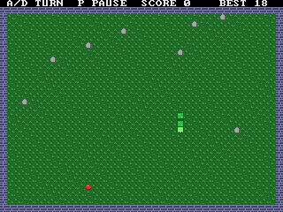

# Snake for the Picocomputer 6502

A Snake game for the [Picocomputer 6502](https://picocomputer.github.io/)
(RP6502), written in C. It builds with either cc65 or llvm-mos.



## How to play

Steer the snake to the apples. Every apple makes the snake longer and
drops a stone in the cell the tail leaves. Don't run into a wall, a
stone or yourself.

| Key   | Action        |
|-------|---------------|
| A     | Turn left     |
| D     | Turn right    |
| P     | Pause / resume|
| Space | Start         |
| ESC   | Quit          |

You steer relative to the snake's head: A and D turn it left and right
from the direction it is heading.

- **It gets faster.** The snake speeds up every 4 apples until it reaches
  twice its starting speed.
- **Stones build up.** Stones from apples stay on the board for a while.
  At first only 4 stay, but the limit grows as you eat more apples.
- **Golden apple.** After every 5th apple a golden apple appears for 5
  seconds. It is worth 5 points and blinks before it disappears.
- **High score.** Your best score is shown on the top row and saved in
  `snake.hi` on the USB drive.

## Building

Requirements:
 * CMake 3.21 or newer
 * Python 3
 * Make or Ninja
 * [cc65 or llvm-mos](https://github.com/picocomputer?view_as=public)

The install steps for Windows, macOS and Linux are in the
[RP6502 SDK documentation](https://picocomputer.github.io/sdk.html#sdk-install).

Build with one of the CMake presets (`cc65/Debug`, `cc65/Release`,
`llvm-mos/Debug`, `llvm-mos/Release`):

```bash
cmake --preset cc65/Release
cmake --build --preset cc65/Release
```

The game ends up in `build/cc65/release/snake.rp6502`.

## Running

- **Emulator:** the first configure fetches the emulator into `tools/`.
  Run `tools/rp6502-emu build/cc65/release/snake.rp6502`, or use the
  `RP6502-EMU` launch configuration in VS Code.
- **Picocomputer:** use the `RP6502-PICO` launch configuration in VS Code
  to send the game over USB, or copy `snake.rp6502` to a USB drive and load
  it from the monitor.

## How it works

Everything is in [src/main.c](src/main.c), and the comment at the top
explains how the game was built up step by step. In short:

- **Graphics:** a 40x30 tile map (VGA mode 2, 8x8 tiles, 16 colors), a text
  row on top for the score (mode 1), and two sprites for the snake's head
  and tail (mode 5). The sprites slide a pixel at a time, so the snake moves
  smoothly even though the game logic works in whole cells.
- **Animation without redrawing:** the board is split into 16 diagonal bands
  with their own grass tiles, and the wind rewrites only the tile images of
  the bands where the grass changes pose. The glowing
  walls, glinting apple and blinking golden apple change palette entries.
  The game-over shake moves the tile map's `x_pos`.
- **Sound:** the RIA's PSG plays the sound effects, controlled through 64
  bytes in XRAM.

## Updating the tools

`tools/` holds the CMake and Python scripts that the SDK runs. Update them
with the "RP6502: update tools" task (Terminal > Run Task), or with:

```bash
cmake -P tools/rp6502.cmake
```

This project started from the
[RP6502 SDK template](https://github.com/picocomputer/rp6502-sdk).
